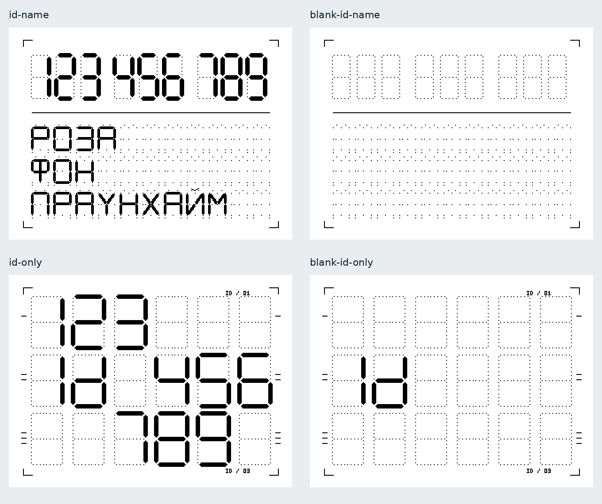

# CyberpunkIdPrinter

Python-пакет **`cyberwall_id_printer`**: рисование и печать ID с именем на термопринтере.
ID — крупные семисегментные цифры с группировкой `123 456 789`; имя — заглавная
кириллица или латиница. Активные сегменты чёрные, неактивные обозначены точками.
Макет по умолчанию — **40 × 30 мм**, без полутонов и dithering.



**Версия 0.3.1 — серии отпечатков и проверка соединения.** Пользователь подтвердил печать тестового
ID с именем на термопринтере через CLI версии 0.1.2 на Windows. Новые макеты
проверены программно; их читаемость и удобство ручного заполнения нужно оценить
на бумаге. Команды позиционирования этикеток этого профиля пока не реализованы.

## Установка

Python **3.11+**. Из папки этого репозитория:

```console
python -m venv .venv
```

Активируйте окружение (`.venv\Scripts\Activate.ps1` в PowerShell,
`source .venv/bin/activate` в Linux/macOS), затем:

```console
python -m pip install -e .
```

Pillow устанавливается автоматически вместе с пакетом. Для рисования и Bluetooth:

```console
python -m pip install -e ".[printer]"
```

Также можно устанавливать пакет по Git URL с указанием нужного коммита. Имя импорта и имя пакета — `cyberwall_id_printer`.
Пакет пока не опубликован в PyPI.

### Windows / Python 3.14: обновление после ошибки winsdk

В версии 0.1.0 зависимость `winsdk` была добавлена избыточно. Она нужна TiMini
для Bluetooth Classic; наш BLE-адаптер использует Bleak. Начиная с 0.1.1
`winsdk` не устанавливается. Для этого исправления не нужны Visual Studio,
смена Python или удаление существующего виртуального окружения.

В PowerShell из папки репозитория:

```powershell
git pull --ff-only
.\.venv\Scripts\python.exe -m pip install -e ".[printer]"
.\.venv\Scripts\python.exe -m cyberwall_id_printer --version
```

Ожидаемая версия — `0.3.1`. Явный путь к Python устанавливает зависимости
именно в `.venv`, даже без её активации. Если окружение ещё не создано, сначала
выполните `python -m venv .venv` один раз. Для использования нашего адаптера
не нужно устанавливать весь `requirements.txt` внешнего TiMini: зависимости
BLE уже перечислены в `[printer]`.

## TiMini Print — отдельная зависимость

Исходники [TiMini Print](https://github.com/Dejniel/TiMini-Print) **не входят** в этот
репозиторий и wheel. Upstream не предоставляет устанавливаемый Python-пакет,
поэтому адаптер использует отдельную папку исходников. Для воспроизводимости
поддерживается один закреплённый коммит:

```text
679fc0650e61c7ab28b44542b9b9ba000e45aa78
```

Из каталога **рядом** с CyberpunkIdPrinter:

```console
git clone https://github.com/Dejniel/TiMini-Print.git TiMini-Print
git -C TiMini-Print checkout --detach 679fc0650e61c7ab28b44542b9b9ba000e45aa78
```

Укажите абсолютный путь к этой папке. PowerShell:

```powershell
$env:CYBERWALL_TIMINI_PATH = (Resolve-Path ..\TiMini-Print).Path
```

Linux/macOS:

```bash
export CYBERWALL_TIMINI_PATH="$(realpath ../TiMini-Print)"
```

Проверка без подключения к принтеру:

```console
cyberwall-id-printer check-backend
```

Вместо переменной можно передать `--timini-path /path/to/TiMini-Print` в CLI или
`TiMiniBackend(path=...)` в Python. Адаптер проверяет SHA и чистоту checkout.
Обновление upstream — отдельное осознанное изменение адаптера с проверкой
совместимости. Импорт библиотеки ничего не скачивает и не включает Bluetooth.
TiMini Print распространяется отдельно под Apache-2.0; его зависимости и
лицензии сохраняются в собственном проекте.

Поиск BLE-принтеров занимает 15 секунд по умолчанию — как в команде `scan`,
так и перед подключением. В API тайм-аут можно изменить через
`TiMiniBackend(scan_timeout=...)`. Тайм-аут BLE-подключения и операций —
`timeout=20`, число попыток подключения — `connect_attempts=2` (всего).

## Рисование без принтера

```console
cyberwall-id-printer render --id 123456789 --name "Роза фон Праунхайм" --width-mm 40 --height-mm 30 --output label.png --preview preview.png
```

```python
from cyberwall_id_printer import LabelConfig, render_label

config = LabelConfig(width_mm=40, height_mm=30, dpi=203.2)
image = render_label("123456789", "Роза фон Праунхайм", config)
image.save("label.png", dpi=(config.dpi, config.dpi))
```

Нативный PNG: **320 × 240 точек**, режим Pillow `1`. Preview увеличен в четыре
раза только для просмотра. ID храните строкой: так сохраняются начальные нули.
Нужны ровно девять цифр ASCII. Имя нормализуется в Unicode NFC, переводится в
верхний регистр. Имя занимает постоянную сетку **3 × 11**: каждое слово
на отдельной строке, максимум три слова по 11 символов (включая дефисы и
знаки препинания). Неиспользуемые позиции тоже содержат по 14 опорных точек.
Для ручного заполнения на 40 × 30 мм нужен тонкий наконечник.
Слишком длинное имя или неизвестный символ вызывает `ValueError`, а не
исчезает с этикетки. Поддержаны все 33 русские буквы, A–Z, цифры, пробел,
дефис, точка и апостроф. Буквы стилизованы, некоторые похожи друг на друга.

## Четыре режима макета

| `--mode` / `LabelMode` | Содержимое | Аргументы |
| --- | --- | --- |
| `id-name` / `ID_NAME` | ID и имя; режим по умолчанию | `--id` и `--name` |
| `blank-id-name` / `BLANK_ID_NAME` | Пустые поля ID и имени | Без ID и имени |
| `id-only` / `ID_ONLY` | ID крупно, три строки по три цифры | Только `--id` |
| `blank-id-only` / `BLANK_ID_ONLY` | Пустой бланк крупного ID | Без ID и имени |

В режиме без имени сетка имеет 3 × 6 позиций. Цифры начинаются с позиций
1, 4 и 3 соответственно. Сегментная метка `Id` остаётся во второй строке
даже на пустом бланке; все свободные и неактивные сегменты показаны точками.
Уголки, тонкие риски строк и декоративные подписи `ID / 01`, `ID / 03` сохранены.
Размер макета задаётся явно через `width_mm`/`height_mm`; ширина рулона сама по
себе не растягивает изображение. По умолчанию все режимы — 40 × 30 мм.

```console
cyberwall-id-printer render --mode id-name --id 123456789 --name "Роза фон Праунхайм" --output id-name.png
cyberwall-id-printer render --mode blank-id-name --output blank-id-name.png
cyberwall-id-printer render --mode id-only --id 123456789 --output id-only.png
cyberwall-id-printer render --mode blank-id-only --output blank-id-only.png
```

Пример `examples/render_modes.py` создаёт все четыре PNG в `examples/output/`;
его можно запускать кнопкой Python в VS Code. Готовые образцы также лежат в
`docs/id-name.png`, `docs/blank-id-name.png`, `docs/id-only.png`, `docs/blank-id-only.png`.

Те же режимы доступны в `print`. Не передавайте ненужные данные в пустые
режимы: это ошибка, чтобы случайно не потерять введённый ID или имя.
`--no-inactive` убирает точки в заполненных режимах; для пустых бланков он
запрещён. `--no-decorations` убирает уголки, разделитель, риски и мелкие подписи,
но сохраняет сегментную метку `Id` в режимах без имени.

```python
from cyberwall_id_printer import LabelConfig, LabelMode, render_label

render_label(config=LabelConfig(mode=LabelMode.BLANK_ID_NAME)).save("blank.png")
render_label("123456789", config=LabelConfig(mode=LabelMode.ID_ONLY)).save("id.png")
```

## Подключение и печать

Первый тест выполняйте на **непрерывной бумаге**. Закройте FunPrint / TiMini GUI,
чтобы они не удерживали соединение, и включите Bluetooth.

```console
cyberwall-id-printer scan
cyberwall-id-printer info --address "PRINTER_ADDRESS"
cyberwall-id-printer print --address "PRINTER_ADDRESS" --paper continuous --roll-width-mm 57 --width-mm 40 --height-mm 30 --id 123456789 --name "Роза фон Праунхайм"
```

`PRINTER_ADDRESS` замените адресом из `scan`. В первой версии соединение — **BLE**;
USB и Bluetooth Classic в публичный адаптер пока не включены. Основная цель —
термопринтер с профилем `v5g_small_203`. Поддерживаются простые рулонные профили V5G/V5X;
остальные семейства отклоняются до инициализации принтера.

Асинхронный API для приложений:

```python
import asyncio
from cyberwall_id_printer import Printer, MediaConfig, TiMiniBackend

async def main():
    backend = TiMiniBackend(blackening=3)  # 1..5
    async with Printer(backend, media=MediaConfig(
        width_mm=40, height_mm=30, roll_width_mm=57,
    )) as printer:
        capabilities = await printer.connect("PRINTER_ADDRESS")
        print(capabilities)
        result = await printer.print_id("123456789", "Роза фон Праунхайм")
        print(result.status)  # sent: передача завершена, физическая печать не подтверждена

asyncio.run(main())
```

Синхронный API для скриптов:

```python
from cyberwall_id_printer import SyncPrinter, MediaConfig, LabelMode

with SyncPrinter(media=MediaConfig()) as printer:
    printer.connect("PRINTER_ADDRESS")
    result = printer.print_id("123456789", "Роза фон Праунхайм")
    printer.print_id(mode=LabelMode.BLANK_ID_NAME)
    printer.print_id("123456789", mode=LabelMode.ID_ONLY)
    printer.print_id(mode=LabelMode.BLANK_ID_ONLY)
```

Этот пример печатает четыре макета через одно соединение. В асинхронном API
те же вызовы используются с `await`. Существующий `print_id(id, name)` по-прежнему
работает без изменения аргументов, но использует новую постоянную сетку имени.

`Printer` живёт в одном asyncio event loop. `SyncPrinter` сохраняет один event
loop на всю сессию и должен создаваться, использоваться и закрываться в одном
потоке. В GUI используйте отдельный рабочий поток либо асинхронную интеграцию;
не вызывайте блокирующий фасад из потока интерфейса или запущенного asyncio loop.
Не управляйте одним принтером одновременно из нескольких экземпляров/процессов.

## Бумага и этикетки

| Параметр `MediaConfig` | Значение |
| --- | --- |
| `paper_type` | `PaperType.CONTINUOUS` или `PaperType.LABELS` |
| `width_mm`, `height_mm` | Размер одного печатаемого макета; по умолчанию 40 × 30 мм |
| `roll_width_mm` | Полная ширина ленты вместе с подложкой, по умолчанию 57 мм |
| `offset_x_mm` | Смещение макета от центра головки; положительное — вправо |
| `dpi` | Расчётный масштаб макета, по умолчанию 203.2, то есть 8 точек/мм |

Для ленты 40 мм задайте её **фактическую** ширину вместе с подложкой; сам стикер
может оказаться уже. Ширина рулона проверяется относительно ширины макета, но
не является обещанием, что конкретная лента механически подходит принтеру.
Библиотека не может определить положение узкого рулона в отсеке: его нужно
зафиксировать направляющими и при необходимости настроить `offset_x_mm`.

В профиле `v5g_small_203` у TiMini номинальный DPI равен 200. Здесь сохранены 203.2 DPI
согласованного макета. Для точного физического размера проверьте линейкой
тестовый отпечаток и задайте подходящий `dpi`; `info` показывает номинал профиля.
При 203.2 DPI макет 40 мм занимает 320 точек и дополняется белыми полями до
384 точек головки: по 32 точки с каждой стороны. Растягивания, обрезки и
повторного dithering нет. Размер и смещение, выходящие за головку, отклоняются.

На непрерывной бумаге высота задаёт растр макета. Upstream может дополнительно
протянуть бумагу после задания; общий расход ленты **не равен ровно 30 мм**.

### Поддержка границ стикеров

| Профиль | Непрерывная бумага | Аппаратный режим этикеток | Калибровка |
| --- | --- | --- | --- |
| V5G_SMALL_203 | Одиночная печать подтверждена пользователем; серия требует проверки | Пока нет команд в адаптере | Пока нет команд |
| V5X с TAG preset | Реализовано | Подключена TAG-команда upstream, требуется физическая проверка | Пока нет команд |

**Поддержка этикеток в FunPrint не отрицается.** На проверенном термопринтере приложение умеет
калибровать ленту, но соответствующие команды пока не перенесены в адаптер.
`hardware_labels=False` означает ограничение текущей интеграции, а не отсутствие
датчика у принтера. Библиотека никогда не подменяет поиск границы расчётной
протяжкой на длину стикера.

```python
from cyberwall_id_printer import MediaConfig, PaperType

# Внутри подключённой async-сессии, только если capability доступна:
labels = MediaConfig(paper_type=PaperType.LABELS,
                     width_mm=40, height_mm=30, roll_width_mm=40)
await printer.configure_media(labels)
if printer.capabilities.calibration:
    await printer.calibrate()
await printer.print_id("123456789", "Роза фон Праунхайм")
```

Для профиля V5G `configure_media(labels)` и печать с исходным `paper_type=LABELS`
выдают `UnsupportedFeature` **до отправки печатного задания**. `calibrate()`
также явно сообщает о неподдерживаемой операции. Доступен CLI
`cyberwall-id-printer calibrate --address "PRINTER_ADDRESS"` для будущей
реализации. Настройки носителя применяются при подготовке следующего задания;
`configure_media()` сама не перемещает бумагу и не отправляет команд.

## Ошибки и повторная печать

- `ValueError`: неверный ID, имя, геометрия или параметры; ничего не отправлено.
- `BackendUnavailable`: нет закреплённого checkout или нужных зависимостей.
- `UnsupportedFeature`: адаптер пока не умеет эту функцию.
- `ConnectionStateError`: нет соединения, неверный event loop или сессия требует восстановления.
- `PrintTransmissionError`: передача оборвалась; `may_have_printed=True`.

При сбое или отмене отправки часть либо всё задание могло попасть в принтер.
Автоматического повтора нет. Сессия блокирует следующую печать: проверьте ленту,
отключитесь и подключитесь заново, затем примите решение о повторе в приложении.
Успех возвращается как `PrintResult(status="sent", physical_completion_confirmed=False)`.
Это не подтверждение физического завершения печати. Ошибки обнаружения и
подключения могут дополнительно приходить из TiMini/Bleak.

## Структура и расширение

- `renderer.py`: чистое рисование, кириллица и сегментные глифы.
- `models.py`, `layout.py`: носитель, возможности и размещение на головке.
- `printer.py`: асинхронная сессия, последовательная отправка, обработка ошибок.
- `sync.py`: блокирующий фасад для скриптов.
- `backends/base.py`: контракт `PrinterBackend` для других адаптеров.
- `backends/timini.py`: проверка внешнего TiMini и работа с его протоколом.
- `cli.py`, `examples/`: автономная проверка без Master Manager.

Master Manager и приложение коллеги импортируют этот пакет и передают ID/имя.
База пользователей и RFID остаются на стороне вызывающего приложения.
Для добавления команд этикеток понадобится запись обмена FunPrint при выборе типа
бумаги и калибровке, затем разбор и испытание на подходящей ленте. После этого
новые возможности включаются в адаптере без изменения API приложений.

## Разработка и проверки

```console
python -m unittest discover -s tests -v
```

Без `CYBERWALL_TIMINI_PATH` тесты настоящего кодировщика пропускаются. С внешним
checkout и установленным `[printer]` запускаются также проверки профилей V5G/V5X:
кодирование реального задания, монохромная полярность и запрет этикеток этого профиля.
Никакой тест не подключается к физическому принтеру и не двигает бумагу.

Оригинальные исходники этого проекта пока без выбранной открытой лицензии.
Лицензию можно добавить перед публичным распространением; лицензия TiMini
Print действует только на его отдельный проект.

CI проверяет основной пакет и полную установку `[printer]` на Windows/Linux с
Python 3.11–3.14. Зависимости для `[printer]` устанавливаются только из готовых
wheel, чтобы доступный в CI компилятор не скрывал подобные ошибки установки.
Тесты BLE проверяют импорты и выбор транспорта без `winsdk`; физическое
соединение и печать по-прежнему проверяются отдельно на устройстве.

## Серия отпечатков и проверка связи (0.3.0)

```python
from cyberwall_id_printer import SyncPrinter, TiMiniBackend, LabelMode

with SyncPrinter(TiMiniBackend(path='../TiMini-Print')) as printer:
    printer.connect('PRINTER_ADDRESS')
    result = printer.print_id(mode=LabelMode.BLANK_ID_NAME, copies=10)
    print(result.copies, result.status)  # 10, sent
    print(printer.check_connection())   # Состояние Bluetooth, без движения бумаги
    printer.print_id('123456789', mode=LabelMode.ID_ONLY)
```

Асинхронный `Printer` принимает те же параметры с `await`. CLI:

```console
cyberwall-id-printer print --address PRINTER_ADDRESS --paper continuous --mode blank-id-only --copies 10
```

`copies` — целое число 1–100, по умолчанию 1. Для серии изображение рисуется один
раз, затем кодируются отдельные страницы с номерами и общим количеством. Они
объединяются штатным `raster_pages_job()` TiMini с сохранением протокольных шагов;
`send_job()` вызывается один раз. Между экземплярами не требуется ввод пользователя
или переподключение. Размер в `PrintResult` относится к одному отпечатку.

`check_connection()` обновляет состояние BLE без команды печати. В закреплённом
TiMini нет публичного API этого состояния на `ConnectedPrinter`, поэтому адаптер
использует изолированный доступ к его транспорту и обрабатывает события на
внутреннем BLE event loop через штатный рабочий поток TiMini. Это проверяется
тестом и требует пересмотра при обновлении закреплённой ревизии.
После `False` вызови `disconnect()` и затем `connect()`; библиотека сама не
переподключается. Master Manager выполняет эти действия в фоновом сервисе.

Ошибка или отмена передачи делает сессию неопределённой до переподключения.
Серия не сохраняется и не повторяется, включая её предполагаемый остаток.
`physical_completion_confirmed=False` остаётся в результате: число копий —
запрошенное количество, а не счётчик физически напечатанных наклеек.

Регулирование передачи остаётся штатным для профиля TiMini. Для V5G это порции
данных с паузой 30 мс; хотя runtime разбирает уведомления паузы/продолжения,
BLE-профиль этой ревизии не ожидает их перед записью. Мы не включаем непроверенный
режим и не обещаем подтверждение свободного буфера. Перед рабочей серией проверь
10 экземпляров на устройстве; возможны штатные паузы подачи и охлаждения.
Тесты без устройства проверяют кодирование страниц, одну отправку, отсутствие
повтора после ошибки и обнаружение потери связи, но не физическую печать серии.

Для собственного backend новые методы: `prepare_copies(image, media, copies)`
(без I/O) и `check_connection()` (async). Старый backend продолжает поддерживать
одиночную печать; неподдерживаемая серия/проверка связи выдаёт `UnsupportedFeature`.

## Автономная сборка Master Manager

Начиная с 0.3.1 адаптер поддерживает встроенный TiMini внутри PyInstaller EXE.
В исходниках по-прежнему используется отдельный чистый checkout; копии TiMini
в этом репозитории нет. Сборщик проверяет Git-ревизию, включает runtime-модули,
JSON-каталог, зависимости и лицензии и записывает `cyberwall_timini.json`.
В EXE адаптер читает этот манифест и загружает только встроенный модуль.
Git, Python, pip и отдельный checkout на целевом ПК не нужны.

Полный Windows ZIP собирается workflow **Windows standalone manager** в этом
репозитории: **Actions → Windows standalone manager → Run workflow**.
`manager_ref` — ветка или коммит CyberpunkMasterManager, по умолчанию `master`.
Результат находится в Artifacts → `cyberwall-master-manager-windows-x64`.
Workflow расположен здесь, поскольку библиотека приватная; дополнительный токен
для доступа из другого репозитория не требуется. Код Master Manager и TiMini
получается при сборке, не копируется в исходники библиотеки.

## Экспериментальные отдельные стикеры (0.4.0)

`LabelPrinter` реализует вариант 2: печать → выдача → ожидание следующего
задания → втягивание → F0 → следующая печать. Настройки, восстановление после
ошибок и интерактивный пример: [docs/labels_v2.md](docs/labels_v2.md).
Прежние `Printer`/`SyncPrinter` и CLI используют обычный алгоритм.
