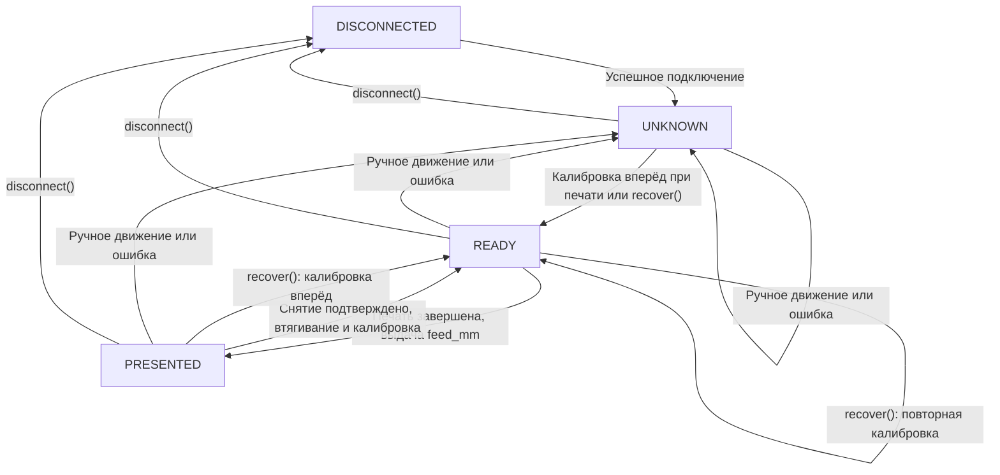
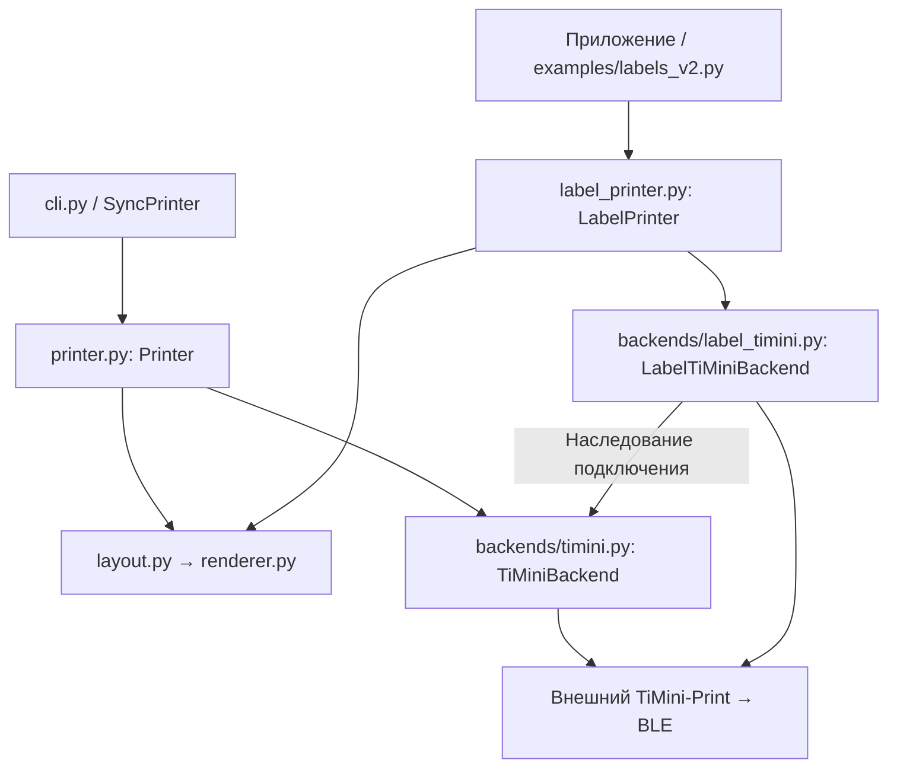

# CyberpunkIdPrinter

**CyberpunkIdPrinter** — Python-библиотека `cyberwall_id_printer` для создания и печати игровых ID-этикеток на термопринтере. Она рисует монохромный макет с крупным девятизначным ID и сегментным именем, подключается к принтеру по **Bluetooth Low Energy (BLE)** и управляет печатью как на непрерывной ленте, так и на отдельных самоклеящихся этикетках.

Библиотека отвечает за изображение, BLE-подключение, отправку задания и движение ленты. **Аккаунты, база данных, RFID-карты и пользовательский интерфейс** остаются в вызывающем приложении (например, [CyberpunkMasterManager](https://github.com/limbura/CyberpunkMasterManager) или [CyberpunkChangeId](https://github.com/limbura/CyberpunkChangeId)).


Основные возможности:

- четыре варианта макета: ID с именем, только ID и пустые бланки обоих форматов;
- создание готового PNG **без принтера** (Pillow, 1 бит, без полутонов и дизеринга);
- печать на непрерывной бумаге через `Printer` / `SyncPrinter`;
- позиционирование, калибровка, подача, втягивание и серии самоклеящихся этикеток через `LabelPrinter`;
- проверка состояния принтера, сообщения об ошибках бумаги и отмена без автоматического повторения потенциально напечатанного задания;
- CLI для генерации макетов, поиска BLE-принтеров и обычной печати; асинхронный Python API для интеграции в приложения.

Базовый макет — **40 × 30 мм**, **320 × 240 точек** при 203,2 DPI (8 точек/мм). Для профиля `v5g_small_203` растровое изображение дополняется белым полем до ширины печатающей головки **384 точки**.

## Установка

Требуется **Python 3.11+**. Из каталога репозитория:

```powershell
python -m venv .venv
.\.venv\Scripts\python.exe -m pip install -e ".[printer]"
```

Для одного только рисования макетов, без Bluetooth и принтера, достаточно:

```powershell
python -m pip install -e .
```

В Linux/macOS используйте Python из `.venv/bin/python`. Пакет устанавливается из исходников репозитория или архива GitHub Release; в PyPI он не опубликован. Имя импорта — `cyberwall_id_printer`, команда после установки — `cyberwall-id-printer`.

### Внешняя зависимость TiMini-Print

Для работы с реальным принтером нужна отдельная копия [TiMini-Print](https://github.com/Dejniel/TiMini-Print), предоставляющая протоколы принтеров и BLE-транспорт. Она **не входит** в исходники или Python-пакет CyberpunkIdPrinter.

Библиотека использует закреплённую и проверяемую ревизию TiMini-Print:

```text
679fc0650e61c7ab28b44542b9b9ba000e45aa78
```

Разместите репозитории в соседних папках:

```powershell
git clone https://github.com/Dejniel/TiMini-Print.git ../TiMini-Print
git -C ../TiMini-Print checkout --detach 679fc0650e61c7ab28b44542b9b9ba000e45aa78
$env:CYBERWALL_TIMINI_PATH = (Resolve-Path ../TiMini-Print).Path
cyberwall-id-printer check-backend
```

В Linux/macOS путь можно указать через `export CYBERWALL_TIMINI_PATH="$(realpath ../TiMini-Print)"`. Вместо переменной окружения можно передать `--timini-path` в CLI, `TiMiniBackend(path=...)` или `LabelPrinter(timini_path=...)` в Python.

При работе из исходников библиотека проверяет **точный Git-коммит и отсутствие незакоммиченных изменений** в TiMini-Print. Импорт `cyberwall_id_printer` ничего не скачивает и не устанавливает Bluetooth-соединение. В автономных EXE приложений зависимости упаковываются внутрь сборки.

## Быстрый старт

### 1. Нарисовать этикетку без принтера

```powershell
cyberwall-id-printer render --id 123456789 --name "Роза фон Праунхайм" --output label.png --preview preview.png
```

`label.png` содержит исходный растр для печати, `preview.png` — увеличенное в 4 раза изображение для просмотра.

То же из Python:

```python
from cyberwall_id_printer import LabelConfig, render_label

config = LabelConfig(width_mm=40, height_mm=30, dpi=203.2)
image = render_label("123456789", "Роза фон Праунхайм", config)
image.save("label.png", dpi=(config.dpi, config.dpi))
```

### 2. Найти принтер и проверить подключение

Закройте другие программы, удерживающие Bluetooth-соединение с принтером, и включите BLE.

```powershell
cyberwall-id-printer scan
cyberwall-id-printer info --address "PRINTER_ADDRESS"
```

Вместо `PRINTER_ADDRESS` укажите адрес, возвращённый `scan`. Поиск BLE занимает 15 секунд по умолчанию. Адаптер работает с поддерживаемыми профилями TiMini V5G/V5X; для отдельной этикеточной механики `LabelPrinter` нужен **`v5g_small_203`**.

### 3. Напечатать на непрерывной ленте

```powershell
cyberwall-id-printer print --address "PRINTER_ADDRESS" --paper continuous --roll-width-mm 57 --width-mm 40 --height-mm 30 --id 123456789 --name "Роза фон Праунхайм"
```

Команда CLI `print` использует обычный `Printer`. Для отдельных этикеток с калибровкой и выдачей используйте **`LabelPrinter` из Python** (ниже): параметр `--paper labels` сам по себе не включает этот алгоритм на V5G.

## Варианты макета и правила данных

| Режим CLI / `LabelMode` | Содержимое | Входные данные |
| --- | --- | --- |
| `id-name` / `ID_NAME` | Девятизначный ID и имя | ID + имя |
| `id-only` / `ID_ONLY` | Крупный ID, 3 строки по 3 цифры | ID |
| `blank-id-name` / `BLANK_ID_NAME` | Пустые сегментные поля ID и имени | Без ID и имени |
| `blank-id-only` / `BLANK_ID_ONLY` | Пустой бланк крупного ID | Без ID и имени |

Изображения каждого формата: [ID + имя](docs/id-name.png), [только ID](docs/id-only.png), [пустой ID + имя](docs/blank-id-name.png), [пустой ID](docs/blank-id-only.png).

```powershell
cyberwall-id-printer render --mode id-name --id 123456789 --name "Роза фон Праунхайм" --output id-name.png
cyberwall-id-printer render --mode id-only --id 123456789 --output id-only.png
cyberwall-id-printer render --mode blank-id-name --output blank-id-name.png
cyberwall-id-printer render --mode blank-id-only --output blank-id-only.png
```

`examples/render_modes.py` также генерирует все четыре изображения.

**ID:** ровно девять цифр ASCII без пробелов. Рекомендуется передавать строку, чтобы сохранить ведущие нули. На этикетке ID отображается группами по три цифры: `123 456 789`.

**Имя:** нормализуется по Unicode NFC, переводится в верхний регистр и занимает до **трёх строк по 11 символов**. Поддерживаются русские буквы (включая Ё), латинские A–Z, цифры, пробелы, `-`, `_`, точка и апостроф. Неподдерживаемые символы заменяются на `_`. Пустое имя не останавливает печать ID; длинное имя обрезается.

Предупреждения Python позволяют приложению объяснить изменения пользователю:

- `UnsupportedNameCharactersWarning` — неподдерживаемые символы заменены;
- `NameTruncatedWarning` — превышено количество слов или длина слова;
- `InvalidNameWarning` — имя отсутствует или состоит из пробелов.

Изначальное имя в БД библиотека не изменяет. Включённые по умолчанию точки неактивных сегментов и декоративные элементы можно отключать параметрами `inactive=False`, `decorations=False` либо флагами `--no-inactive`, `--no-decorations`. Для пустых бланков отключение неактивных сегментов не поддерживается.

## API печати на непрерывной бумаге

Асинхронный вариант:

```python
import asyncio
from cyberwall_id_printer import Printer, MediaConfig, TiMiniBackend

async def main():
    backend = TiMiniBackend(blackening=3)  # 1–5
    media = MediaConfig(width_mm=40, height_mm=30, roll_width_mm=57)
    async with Printer(backend, media=media) as printer:
        await printer.connect("PRINTER_ADDRESS")
        result = await printer.print_id("123456789", "Роза фон Праунхайм", copies=2)
        print(result.status, result.copies)

asyncio.run(main())
```

Синхронный вариант для обычного скрипта:

```python
from cyberwall_id_printer import SyncPrinter

with SyncPrinter() as printer:
    printer.connect("PRINTER_ADDRESS")
    printer.print_id("123456789", "Роза фон Праунхайм")
```

`Printer` предназначен для одного `asyncio` event loop. `SyncPrinter` создаёт собственный постоянный цикл и должен вызываться и закрываться из одного потока; из уже работающего async loop его использовать нельзя. Для GUI выбирайте async-интеграцию либо отдельный рабочий поток.

`copies` — от **1 до 100**. Обычный `Printer` формирует серию страниц и отправляет её единым заданием. `check_connection()` проверяет связь без печати; при потере соединения приложение должно вызвать `disconnect()` и подключиться заново.

`PrintResult(status="sent", physical_completion_confirmed=False)` означает, что передача завершилась, **а не что принтер физически допечатал лист**. При сбое или отмене часть задания могла попасть в принтер, поэтому библиотека не повторяет отправку автоматически.

## API отдельных этикеток: LabelPrinter

`LabelPrinter` управляет **отдельными самоклеящимися этикетками** на принтере с профилем `v5g_small_203`. Он использует калибровку положения, ручную подачу и втягивание ленты, контроль статуса и события состояния. Обычные `Printer` / `SyncPrinter` используют другой рецепт печати.

```python
import asyncio
from cyberwall_id_printer import (
    LabelPrinter, LabelSettings, MediaConfig, PaperType,
)

async def main():
    media = MediaConfig(
        paper_type=PaperType.LABELS,
        width_mm=40, height_mm=30,
        roll_width_mm=57, offset_x_mm=-4,
    )
    settings = LabelSettings(
        gap_mm=2, feed_mm=15, retract_mm=25,
        confirmation="always",
    )
    async with LabelPrinter(media=media, settings=settings) as printer:
        await printer.connect("PRINTER_ADDRESS")

        # Первая печать: при неизвестной позиции — калибровка вперёд.
        await printer.print_id("123456789", "РОЗА", copies=2)

        # Приложение должно получить реальное подтверждение оператора:
        # все выступающие этикетки сняты, крышка закрыта.
        await printer.confirm_removed()
        await printer.print_id("987654321", "МАКС")

asyncio.run(main())
```

Для печати готового монохромного изображения шириной **384 точки** доступны `print_image(image)` и `print_copies(image, copies=...)`. `print_id(..., copies=...)` самостоятельно рисует макет. При серии копий между изображениями выполняется подача на `gap_mm`, после последнего — выдача на `feed_mm`; состояние становится `PRESENTED`. Калибровка между копиями не выполняется.

Если следующая печать запрошена из `PRESENTED` без подтверждения снятия этикеток, выбрасывается `RemovalRequired` **до втягивания бумаги**. Задание не ставится в очередь: после подтверждения `confirm_removed()` его нужно отправить снова. Режим `confirmation="never"` отключает программную проверку, но не гарантирует физического снятия этикетки.

### Настройки носителя и движения

| Объект и параметр | Назначение |
| --- | --- |
| `MediaConfig.paper_type` | `CONTINUOUS` или `LABELS` |
| `width_mm`, `height_mm` | Размер печатаемого макета; обычно 40 × 30 мм |
| `roll_width_mm` | Полная ширина ленты вместе с подложкой, а не только наклейки |
| `offset_x_mm` | Смещение макета относительно центра головки; отрицательное — влево |
| `dpi` | Масштаб изображения; по умолчанию 203,2 |
| `LabelSettings.feed_mm` | Выдача этикетки после последней копии; по умолчанию 15 мм |
| `LabelSettings.retract_mm` | Втягивание после снятия предыдущей этикетки; по умолчанию 25 мм |
| `LabelSettings.gap_mm` | Подача между копиями; по умолчанию 2 мм |
| `LabelSettings.confirmation` | `always` (по умолчанию) или `never` |
| `LabelSettings.position_timeout` | Ожидание калибровки, по умолчанию 20 с |
| `LabelSettings.settle_seconds` | Пауза после передачи изображения, по умолчанию 3 с |
| `LabelSettings.motion_settle_seconds` | Пауза после перемещения, по умолчанию 5 с |

Для подачи, втягивания и зазора допустимы **0,25–25 мм**; паузы `settle_seconds` и `motion_settle_seconds` — не менее 2 с. Это временные ожидания, а не датчик завершения печати. `offset_x_mm` и реальную ширину ленты подбирают по тестовому отпечатку; библиотека не умеет механически центрировать узкую ленту.

### Состояния LabelPrinter

`LabelPrinter.state` показывает **известное программe положение ленты**, а не физическое подтверждение выхода этикетки. Основные переходы:



| Состояние | Что означает |
| --- | --- |
| `DISCONNECTED` | Соединение закрыто |
| `UNKNOWN` | Позиция неизвестна: после подключения, ошибки или ручного движения |
| `READY` | Калибровка выполнена; можно печатать без предварительного втягивания |
| `PRESENTED` | Отправка изображения и выдача ленты завершены; этикетку можно снимать |

При обычной печати из `UNKNOWN` сначала выполняется калибровка **вперёд**. Из `READY` печать начинается непосредственно. Из `PRESENTED` после подтверждения снятия библиотека втягивает ленту, повторно калибрует и печатает.

Для обслуживания доступны:

```python
await printer.poll()  # Запросить статус без движения бумаги.
await printer.check_connection()  # Проверить BLE-соединение.
await printer.move_paper(10)  # Подать вперёд; позиция станет UNKNOWN.

# Только когда все выступающие наклейки действительно сняты:
await printer.move_paper(10, reverse=True, removed=True)
await printer.recover()  # Калибровка вперёд → READY.
```

Ручное втягивание требует `removed=True` независимо от режима `confirmation`. `confirm_removed()` только фиксирует подтверждение в `PRESENTED` и **не перемещает бумагу**. `recover()` не втягивает ленту и не повторяет печать.

Отдельно от позиции хранится `device_status`: `unknown`, `normal` или причина неисправности, например `paper_out`. `poll()` обновляет статус; `on_event` получает словарь с событием, состоянием и статусом. После замены бумаги восстановите позицию через `recover()`. При сбое печати `LabelOperationError` содержит этап `stage`, признак `may_have_printed` и исходную причину. Ошибки и отмены переводят положение в `UNKNOWN`; **ни задание, ни его оставшиеся копии автоматически не возобновляются**.

Подробнее: [руководство по работе с этикетками](docs/labels_v2.md) и [интерактивный пример для принтера](examples/labels_v2.py).

## Устройство библиотеки

Основные модули и направления вызовов:



- `renderer.py` — сегментные символы, четыре макета, нормализация ID и имени.
- `layout.py` — размещение растра относительно печатающей головки.
- `models.py` — тип бумаги, геометрия, возможности устройства и `PrintResult`.
- `printer.py`, `sync.py` — обычная асинхронная печать и синхронный фасад.
- `label_printer.py` — отдельный алгоритм этикеток, состояния, подтверждения снятия и серия копий.
- `backends/base.py` — контракт backend для других устройств.
- `backends/timini.py`, `backends/label_timini.py` — поддерживаемые профили, BLE и команды ленты.
- `cli.py` — команды `render`, `check-backend`, `scan`, `info`, `print`, `calibrate`; доступность аппаратных операций зависит от профиля.

Устройство библиотеки не зависит от MySQL и RFID: приложение передаёт готовые ID и имя, получает результат и решает, что показать оператору.

## Ошибки и ограничения

- `ValueError` — некорректные данные ID, параметры изображения или перемещения; ошибка валидации.
- `BackendUnavailable` — нет TiMini-Print, зависимостей или выбранный checkout не соответствует закреплённому коммиту.
- `UnsupportedFeature` — устройство или обычный backend не поддерживает запрошенную операцию.
- `ConnectionStateError` — нет подходящего подключения или нарушен режим использования event loop.
- `DeviceStatusError` — неисправность, которую сообщил принтер (например, отсутствие бумаги).
- `PrintTransmissionError` / `LabelOperationError` — сбой отправки либо последовательности работы с этикеткой; принтер мог частично выполнить задание.
- `RemovalRequired` — для безопасного продолжения необходимо снять выданные наклейки.

BLE-подключение и успешная отправка задания **не являются подтверждением физической печати**. После обрыва связи, сбоя или отмены проверьте устройство и бумагу прежде, чем повторять команду. Библиотека не хранит очередь для автоматического возобновления.

## Разработка, тесты и релизы

```powershell
python -m unittest discover -s tests -v
```

Автотесты проверяют рендеринг, протокол, последовательности печати, ошибки и переходы состояний **без физического принтера**. Для тестов, использующих реальный кодировщик TiMini, требуется установленный `[printer]` и закреплённый checkout. CI запускает проверки на Windows и Linux. Поведение реального датчика ленты, качество печати и движение бумаги нужно проверять на оборудовании; см. [инструкцию по проверке принтера](docs/TESTING_ON_PRINTER.md).

Релиз исходников создаётся workflow [GitHub Actions](.github/workflows/release.yml) при публикации нового тега `vX.Y.Z`, совпадающего с `__version__` в `src/cyberwall_id_printer/__init__.py`. Workflow запускает тесты и публикует архив `cyberwall_id_printer_vX.Y.Z.zip` вместе с `.sha256`. Это **исходники устанавливаемого Python-пакета**, а не готовый Windows EXE и не копия TiMini-Print.

Master Manager и Change ID собирают собственные автономные Windows-приложения в своих репозиториях и включают нужные компоненты в сборку.
